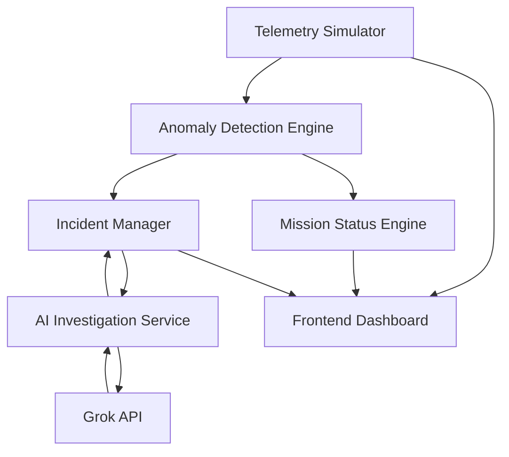

# Technical Requirements Document (TRD)
## Mission Control AI

**Version:** 1.0  
**Status:** MVP  
**Architecture:** Client-server web application

---

## 1. Technical Overview

Mission Control AI is a browser-based application combining simulated telemetry generation, threshold-based anomaly detection, and AI-assisted diagnosis.

The MVP will prioritize speed of development, reliability, and demo performance.

## 2. Technology Stack

| Layer | Technology |
|---|---|
| Frontend | React |
| Language | TypeScript |
| Build Tool | Vite |
| Styling | Tailwind CSS |
| Charts | Recharts |
| Backend | Node.js + Express |
| AI Provider | xAI Grok API |
| Data Format | JSON |
| State Management | React State |
| Deployment | Vercel or similar |

## 3. System Architecture



## 4. Frontend Requirements

### Dashboard Components
- Mission status indicator
- Telemetry metric cards
- Telemetry charts
- Anomaly alert feed
- AI investigation panel
- Scenario control panel

### UI Requirements
- Responsive layout
- Dark aerospace-inspired theme
- Real-time simulated updates
- Loading states
- Error states
- Clear severity indicators

## 5. Backend Requirements

### Telemetry Service
Responsibilities:
- Generate simulated telemetry.
- Maintain current telemetry state.
- Support predefined scenarios.
- Provide telemetry to the frontend.

### Anomaly Detection Service
Responsibilities:
- Evaluate telemetry against configured thresholds.
- Identify abnormal readings.
- Generate anomaly events.
- Assign severity levels.

### AI Investigation Service
Responsibilities:
- Construct prompts using relevant telemetry.
- Send requests to the Grok API.
- Validate structured AI output.
- Return investigation results.
- Handle API errors and timeouts.

### Incident Service
Responsibilities:
- Store detected anomalies in application memory.
- Maintain investigation history.
- Provide incidents to the dashboard.

## 6. AI Integration

The Grok API must be accessed through the backend.

The API key must:
- Be stored in an environment variable.
- Never be exposed to the frontend.
- Never be committed to source control.

Expected configuration:

```env
XAI_API_KEY=your_api_key
```

## 7. Performance Requirements

| Requirement | Target |
|---|---|
| Dashboard initial load | Under 3 seconds |
| Telemetry refresh interval | 1 second |
| AI investigation response | Under 10 seconds target |
| Anomaly detection processing | Under 100 ms |
| Application availability during demo | Reliable for demo duration |

## 8. Error Handling

| Error | Behavior |
|---|---|
| Grok API unavailable | Display error and fallback response |
| Invalid AI response | Validate and retry once |
| Telemetry generation failure | Preserve last known values |
| Missing API key | Display configuration error |
| Network interruption | Show connection status |

## 9. Security Requirements

- Store API keys server-side.
- Validate all incoming requests.
- Limit request frequency.
- Avoid exposing sensitive environment variables.
- Use simulated data only.
- Do not connect to real spacecraft systems.

## 10. Testing Requirements

### Unit Testing
- Threshold evaluation
- Severity assignment
- Telemetry generation
- AI response validation

### Integration Testing
- Anomaly detection to AI investigation
- Frontend to backend API
- Grok API error handling

### Demo Testing
- Normal telemetry scenario
- Engine overheating scenario
- Fuel pressure anomaly scenario
- AI investigation failure scenario

## 11. Technical Constraints

- 100-minute development sprint.
- Limited time for infrastructure.
- No persistent database required for MVP.
- No authentication required.
- No real aerospace data integration.
- The AI response must be explainable and structured.
