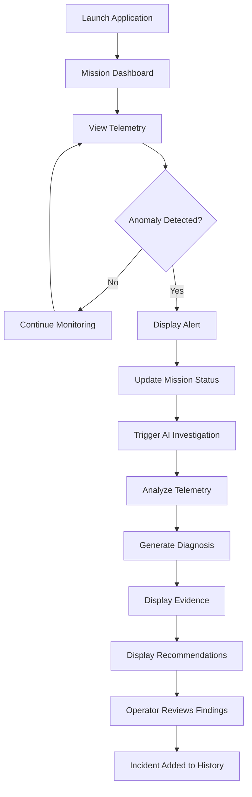

# Application Flow
## Mission Control AI

**Version:** 1.0

---

## 1. Overview

The application flow describes how an operator interacts with Mission Control AI to monitor telemetry, detect anomalies, and investigate potential spacecraft issues.

## 2. Primary User Flow

## 3. Screen Flow

### Screen 1: Mission Dashboard

The operator sees:
- Mission name
- Mission status
- Telemetry metric cards
- Telemetry charts
- Recent anomaly feed
- Scenario controls

Primary action: Select a scenario or investigate an anomaly.

### Screen 2: Anomaly Alert

The system displays:
- Anomaly name
- Affected subsystem
- Severity
- Timestamp
- Triggering telemetry values

Primary action: Investigate anomaly.

### Screen 3: AI Investigation

The system displays:
- Investigation status
- AI-generated summary
- Potential causes
- Supporting telemetry evidence
- Confidence estimates
- Recommended actions

Primary action: Review recommendations.

### Screen 4: Incident History

The operator can review:
- Previous anomalies
- Severity levels
- Investigation summaries
- Timestamps
- Investigation status

## 4. Scenario Flow

### Normal Operation
1. Dashboard loads.
2. Telemetry values remain within expected ranges.
3. Mission status displays NOMINAL.
4. No active anomaly is displayed.

### Engine Overheating
1. Operator selects Engine Overheating.
2. Engine temperature rises.
3. Anomaly detection identifies a threshold violation.
4. Mission status changes to WARNING or CRITICAL.
5. Alert appears.
6. AI investigation is triggered.
7. AI analyzes relevant telemetry.
8. Diagnosis and recommendations appear.

### Fuel Pressure Anomaly
1. Operator selects Fuel Pressure Anomaly.
2. Fuel pressure decreases.
3. System detects abnormal pressure.
4. Alert appears.
5. AI identifies potential fuel system issues.
6. AI provides evidence and investigation steps.

## 5. UI State Transitions

| State | Description |
|---|---|
| NOMINAL | All monitored values within configured limits |
| WARNING | Non-critical anomaly detected |
| CRITICAL | Critical threshold violation |
| INVESTIGATING | AI investigation in progress |
| INVESTIGATED | AI investigation completed |
| ERROR | AI or telemetry service failure |

## 6. Navigation

The MVP should use a single-page dashboard with the following navigation:

- Overview
- Telemetry
- Incidents
- AI Investigation

For the sprint, these may be sections within the same dashboard rather than separate pages.

## 7. UX Principles

- Critical information should be visible immediately.
- Anomalies should be visually distinguishable.
- AI outputs must include supporting evidence.
- Operators should always understand the current mission status.
- AI investigation should be initiated with minimal interaction.
